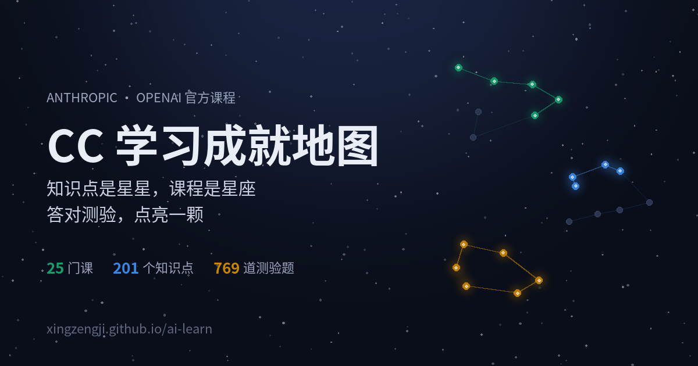

# ai-learn — CC 学习成就地图

一个产品经理（非技术背景）系统学习 Anthropic 与 OpenAI 官方 AI 课程的公开仓库，把整段学习旅程做成了一张可以玩的星空地图。

🌌 **在线地图：[xingzengji.github.io/ai-learn](https://xingzengji.github.io/ai-learn/)**

[](https://xingzengji.github.io/ai-learn/)

## 这是什么

**知识点是星星，课程是星座，实战项目是行星。** 学完一个知识点，点亮一颗星；整座星座点亮，这门课就完成了。

- **25 门课、201 个知识点、769 道测验题**：覆盖 [Anthropic Academy](https://anthropic.skilljar.com/) 的 22 门课和 [OpenAI Academy](https://academy.openai.com/) 的 3 门课，右上角一键切换（[OpenAI 版直达](https://xingzengji.github.io/ai-learn/?v=openai)）
- **答对才能点亮**：点开任意一颗星，先看知识点概要，再做 3–4 道单选题，全对才能点亮。题目选项每次乱序，背位置没用
- **答错了有地方学**：每颗星都链到官方课程页；有公开中文笔记的课，还能一键跳到笔记
- **错题本与「下一颗星」**：答错的题自动收进错题本，随时复习；页面会推荐接下来学哪颗星，新访客也知道从哪开始
- **到期温习与搜索**：点亮满 30 天的星会提醒你再考一题，防止学完就忘；列表页可以按课程、知识点名搜索
- **成就**：第一颗星、第一个完整星座、点满一个天区……解锁时会提示，可以顺手分享
- **实战项目自己认领**：「项目」页列出每个阶段的实战项目，做完后点「我完成了」，对应的行星就会亮起
- **任何人都能玩**：访客的点亮记录存在自己的浏览器里，不需要注册，不影响别人
- **分享我的星图**：一键生成专属链接，别人打开看到的就是你点亮的星空；也能生成一张竖版图片，发朋友圈、小红书。换设备时，在新设备上打开自己的分享链接、点「存为我的星图」，进度就带过去了
- **学习足迹**：底部同步作者的 GitHub 贡献热力图，每次学完提交一次，热力图就多一格

## 怎么用

**直接玩**：打开[在线地图](https://xingzengji.github.io/ai-learn/)，点任意一颗星开始答题。手机也能用。

**看笔记**：公开的中文学习笔记在 [`Course/`](Course/) 下，按厂商分 `Claude/` 和 `Codex/` 两层（哪些课公开、为什么见下方「关于课程笔记」）；完整学习路线见 [`学习计划.md`](学习计划.md)。

**做一份你自己的地图**：见下方「Fork 指南」。

## Fork 指南：做一份你自己的学习地图

地图是纯静态网页，没有构建步骤、没有后端，fork 之后改几处就能用：

1. **Fork** 本仓库
2. 仓库 **Settings → Pages**，Source 选 `Deploy from a branch`，分支选 `main`、目录选 `/docs`，保存后几分钟就能在 `https://<你的用户名>.github.io/ai-learn/` 打开
3. 改 [`docs/index.html`](docs/index.html) 里的几处个人信息：
   - `<meta name="github-user">` 改成你的 GitHub 用户名（热力图读它。热力图数据来自第三方公开接口 `github-contributions-api.jogruber.de`，接口不可用时只是热力图不显示，地图照常能用）
   - `<meta name="repo-url">` 改成你的仓库地址（「看中文笔记」和题目里的「这题有问题？」链到这里）
   - `og:url`、`og:image` 两个分享卡片地址
   - 页脚的仓库链接
4. **不需要清空进度**：地图上没有作者进度，每个人的点亮记录都只存在自己的浏览器里

课程、知识点、题库分别在 `docs/data/<厂商>/` 下的 `courses.json`、`knowledge.json`、`quiz.json`，想换成别的课程体系也是改这几个文件。课程条目里的 `notes` 是仓库内笔记文件夹的路径，有就显示「看中文笔记」，没有就不显示。改完运行 `python3 tools/check-data.py` 校验数据。

本地预览需要起一个服务器（直接双击 HTML 会读不到数据）：

```bash
python3 -m http.server 8000 -d docs   # 然后打开 http://localhost:8000
```

## 仓库结构

| 路径 | 内容 |
|---|---|
| `docs/` | 成就地图网页（GitHub Pages 直接发布），数据在 `docs/data/` |
| `Course/` | 公开的课程中文笔记，按厂商分 `Claude/`、`Codex/` |
| `学习计划.md` | 22 门 Anthropic 课的中文速览、10 周安排 |
| `notes/` | 学习笔记（费曼输出法） |
| `practice/` | 实战项目的方案、需求与复盘 |
| `tools/` | 数据校验 `check-data.py`、网页冒烟测试 `e2e.js` |
| `LICENSE` / `LICENSE-CONTENT.md` | 代码与内容的许可，见下方「许可」 |
| `CONTRIBUTING.md` / `.github/` | 怎么挑错、怎么提 PR；Issue 模板 |

## 关于课程笔记

**只公开有权公开的笔记。** 地图上的每门课作者都学过，但笔记是否放进本仓库，取决于原课程的许可：

- **AI Fluency 系列 9 门**（`Course/Claude/` 下现有的文件夹）：原课程以 CC BY-NC-SA 4.0 发布，中文译述作为改编作品同样以 CC BY-NC-SA 4.0 提供，每篇开头署名原作者并注明来源与许可
- **其余 Anthropic 课程**（Claude 101、Claude Code、API、MCP、Agent Skills 等）：原课程保留全部版权、未开放许可，笔记只留在作者本地，不公开
- **OpenAI Academy 课程**（`Course/Codex/`）：作者自写的学习笔记，不是课件译述

成就地图里的知识点概要和测验题是作者自己写的，不是课程原文。课程内容的版权归原作者所有，本仓库与 Anthropic、OpenAI 无隶属关系。

## 许可

- **代码**（`docs/` 的网页代码、`tools/`）：[MIT](LICENSE)，随便用
- **内容**（课程笔记、题库与知识点数据、学习计划等）：[CC BY-NC-SA 4.0](https://creativecommons.org/licenses/by-nc-sa/4.0/deed.zh-hans)，署名、非商业、相同方式共享

具体哪些文件属于哪一类，见 [`LICENSE-CONTENT.md`](LICENSE-CONTENT.md)。Fork 来换成你自己的课程体系，只用代码部分，不受内容许可的限制。

发现题目或笔记有错，欢迎[提 Issue](https://github.com/XingZengJi/ai-learn/issues/new/choose)，有现成模板，不需要懂代码。想直接提 PR，先看 [`CONTRIBUTING.md`](CONTRIBUTING.md)。
